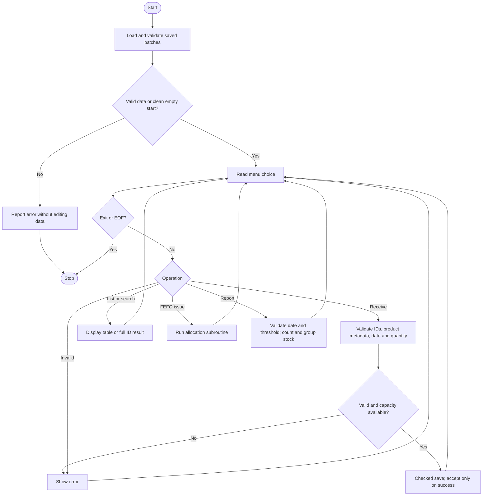
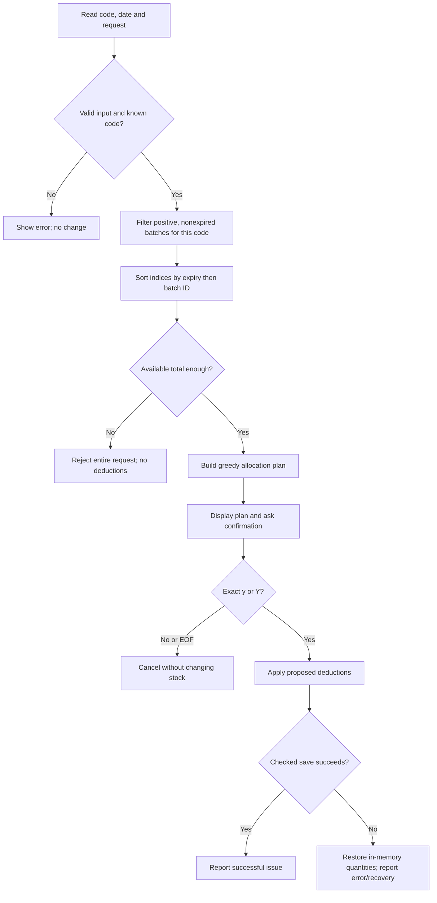

# Algorithm — Lab Reagent Inventory and FEFO Allocation

## Main algorithm

1. Load all batch rows from the local data file.
2. Validate every field, date, quantity, unique batch ID, product metadata and capacity. Stop without editing the file on an invalid/unreadable file or a required backup recovery.
3. If no data and no recovery backup exist, start empty.
4. Display the menu and read a whole line.
5. Dispatch the operation:
   - **Receive:** validate a unique batch ID and a reagent code. For an existing code reuse its name/unit; otherwise read them. Validate expiry and positive whole quantity. Save the candidate before increasing the active count.
   - **List/search:** display the table or the full record found by linear ID search.
   - **FEFO issue:** follow the allocation subroutine below.
   - **Report:** read a valid report date and nonnegative threshold; classify batches; calculate valid totals per code/unit and low-stock flags.
   - **Exit:** stop.
6. On invalid input, report the error and return to the menu. On EOF, cancel an incomplete operation and stop cleanly.
7. Repeat until Exit/EOF.

## FEFO subroutine

1. Read an existing reagent code, valid issue date and positive whole request.
2. Initialise all proposed deductions to zero.
3. Collect indices of batches with the requested code, positive stock and expiry >= issue date. Sum their quantities using a bounded `long` total.
4. Insertion-sort the eligible **indices** by expiry date, then lexicographic batch ID. Do not reorder stored records.
5. If valid total < request, show insufficient stock and stop this operation with no deductions or confirmation prompt.
6. Starting at the first sorted batch, allocate `min(batch quantity, remaining request)` and reduce the remaining request. Continue until it becomes zero.
7. Display the complete allocation plan.
8. Ask for exact `y/Y/n/N`. Cancellation, invalid confirmation or EOF makes no stock change.
9. On confirmation, subtract the proposed quantities from the active records.
10. Save all candidate records through one checked replacement. On a normal save failure, add the proposed deductions back to restore memory. Keep the old main file/backup as indicated by the error/recovery message.

The all-or-nothing rule describes the business operation during normal execution, not a guarantee of power-failure-safe database transactions.

## Why this allocation obeys FEFO

Only eligible batches for one product enter the ordered list. Each earlier batch is used up to its available quantity before a later batch is considered. Every deduction is bounded by that batch's stock and the remaining request. Therefore a successful plan consumes exactly the request, never goes negative, and respects the stated expiry/ID order. This is a deterministic priority policy, not a prediction of future demand or a claim of globally optimal waste reduction.

## Save subroutine

Write all records to a temporary file; check every write and close; preserve the previous main file as backup; install the new file; attempt to restore the old main on installation failure. Keep a previous-main `.bak` after success. Standard C rename steps do not provide multi-user or crash-atomic storage.

## Main flowchart

## FEFO flowchart

